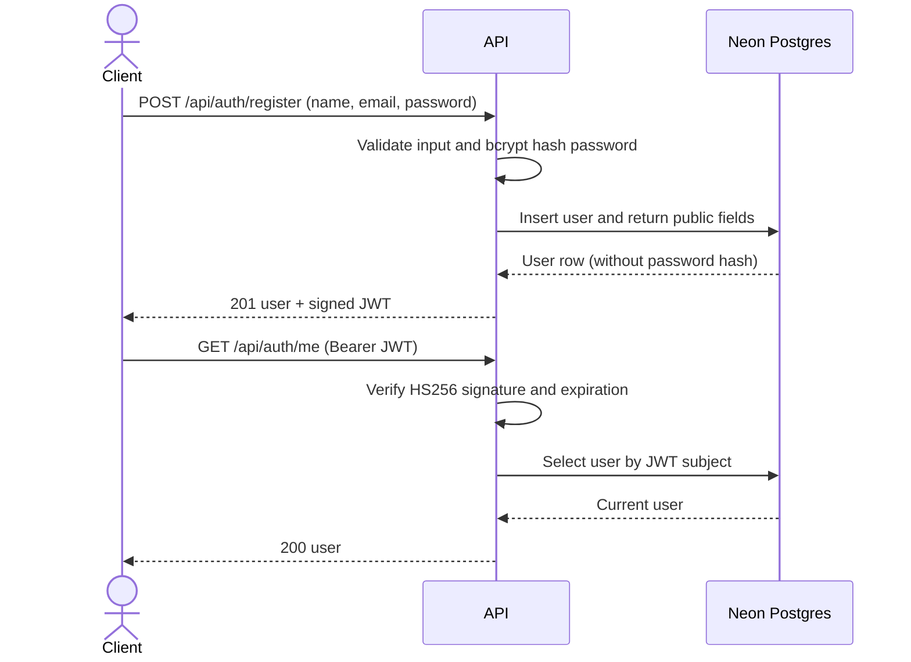

# Notes API

REST API built with Node.js 20+, Express 5, and Neon Postgres.

## Setup

1. Create a Neon project and database. In the Neon Console, copy its connection string for `DATABASE_URL`.
2. Run [`database/schema.sql`](./database/schema.sql) against the database.
3. Copy `.env.example` to `.env`. Set `DATABASE_URL`, a random `JWT_SECRET` of at least 32 characters, and `PORT` if needed.
4. Install dependencies with `npm install`.
5. Start the API with `npm run dev`.

The API listens on `http://localhost:3000` by default. `GET /api/health` checks the database connection.

## Neon test branch and integration tests

Create a separate branch in the Neon Console for tests, preferably from a sanitized development branch. A Neon branch has its own database endpoint and isolates writes from the application branch. Branches may initially contain a snapshot of their parent branch, so avoid exposing production data to test environments.

Copy the test branch's connection string to `TEST_DATABASE_URL` in `.env`, run `database/schema.sql` against that branch, then run `npm test`. The test setup explicitly replaces `DATABASE_URL` with `TEST_DATABASE_URL`; it fails rather than falling back to the application database. The tests use random account emails and delete created users after completion.

The test command uses Node's built-in `node:test` runner and Supertest. To generate a valid expired JWT for `requests.http`, run:

```sh
node --env-file=.env --input-type=module -e "import jwt from 'jsonwebtoken'; console.log(jwt.sign({ sub: 'expired-test' }, process.env.JWT_SECRET, { algorithm: 'HS256', expiresIn: -60 }))"
```

Paste the printed token into `@expiredToken` in `requests.http`.

## Endpoint reference

| Method | Path | Authentication | Description | Success |
| --- | --- | --- | --- | --- |
| `GET` | `/api/health` | No | Check API and database health | `200` |
| `POST` | `/api/auth/register` | No | Create account (`name`, `email`, `password`) | `201` |
| `POST` | `/api/auth/login` | No | Authenticate (`email`, `password`) | `200` |
| `GET` | `/api/auth/me` | Bearer token | Return the current user | `200` |
| `GET` | `/api/notes?q=&tag=&pinned=&page=&limit=` | Bearer token | Search/filter and paginate the current user's notes | `200` |
| `GET` | `/api/notes/:id` | Bearer token | Get one owned note | `200` |
| `POST` | `/api/notes` | Bearer token | Create a note (`title`, `body`, optional `tags`, `pinned`) | `201` |
| `PATCH` | `/api/notes/:id` | Bearer token | Update one or more note fields | `200` |
| `DELETE` | `/api/notes/:id` | Bearer token | Delete an owned note | `204` |

Authentication endpoints are limited to 10 requests per IP every 15 minutes. Registration passwords must be at least 10 characters and contain a letter and a number. The notes list defaults to page 1 and 20 items; `limit` is capped at 100. It returns `{ "notes": [], "pagination": { "page": 1, "limit": 20, "total": 0 } }`.

All note data queries are scoped to the authenticated user. Another user's note returns `404`, the same as a nonexistent note, so the API does not reveal whether someone else's note exists. Note creation takes `user_id` only from the verified token.

Dynamic list filters use nested Neon SQL template fragments rather than SQL string concatenation. For example:

```js
const where = filters.reduce(
  (clause, filter) => sql`${clause} AND ${filter}`,
  sql`WHERE TRUE AND user_id = ${req.user.id}`,
);
```

Interpolated values remain parameterized.

## Authentication flow



A JWT consists of a header, payload, and signature. The payload contains the user ID (`sub`) and expiration (`exp`); it is Base64URL-encoded, not encrypted. The signature detects tampering and verifies authenticity, but anyone holding the token can read the payload. Never put passwords, password hashes, secrets, credentials, or sensitive personal data in it.

## Security protections

- Passwords are hashed with bcryptjs at cost 12 and are never returned by API responses.
- Registration validates inputs, lowercases email addresses, and handles duplicate emails with `409`.
- JWTs are signed with HS256, expire after one hour, and are verified with HS256 only.
- Protected routes require a Bearer token; authentication failures return `401` with `WWW-Authenticate`.
- Note reads, updates, and deletes include the authenticated user ID in their SQL predicates; cross-user access returns `404`.
- Database values and dynamic SQL filters use parameterized Neon tagged-template queries.
- Authentication endpoints have a 10-per-15-minute IP rate limit.
- Helmet, a restricted localhost CORS allowlist, and a 100 KB JSON body limit are enabled.
- Production error responses do not expose stack traces, SQL, or exception details.

Open [`requests.http`](./requests.http) in VS Code with the REST Client extension to exercise the API. Edit its sample emails/passwords before registering, then run requests in order so the named login responses can supply Bearer tokens.
